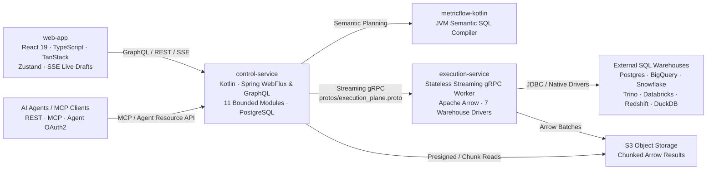

# Monomer

An analytics workspace for teams and their AI agents ([monomer.cc](https://monomer.cc)).

Monomer separates **durable product authority** (semantics, permissions, workspaces, and run lifecycles) from **stateless external warehouse execution** so both humans and AI agents operate over the exact same governed metrics, dashboards, and query execution pipeline.

---

## System Architecture

---

## Architecture Highlights

### 1. Control Plane vs. Stateless Streaming-gRPC Execution Plane
Durable application state, RBAC, and run lifecycles live strictly in `control-service` (PostgreSQL), while external warehouse access is isolated inside a DB-less `execution-service` over a single typed wire contract with deadline and cancellation propagation.
* **Wire Contract:** [`protos/execution_plane.proto`](protos/execution_plane.proto)
* **Run Admission & Lifecycle:** [`ExecutionRunAdmissionService.kt`](control-service/modules/execution-runtime/src/main/kotlin/cc/monomer/execution/application/ExecutionRunAdmissionService.kt)
* **Equivalent Run Reuse (Dashboard Session Deduplication):** [`DashboardUseCases.kt`](control-service/modules/dashboard/src/main/kotlin/cc/monomer/dashboard/application/DashboardUseCases.kt)
* **Cancellation & Deadline-Aware JDBC Driver:** [`JdbcExecutionDriver.kt`](execution-service/driver-jdbc-core/src/main/kotlin/cc/monomer/execution/driver/jdbc/JdbcExecutionDriver.kt)
* **Arrow Encoding & S3 Result Storage:** [`execution-service/arrow/`](execution-service/arrow/) · [`execution-service/object-storage-s3/`](execution-service/object-storage-s3/)

### 2. Shared Semantic Layer & Multi-Warehouse SQL Generation
Dashboards, ad-hoc Explore, and AI agents query the same governed semantic models and metrics compiled to warehouse-specific SQL via [`metricflow-kotlin`](https://github.com/monomerhq/metricflow-kotlin) (a separate versioned JVM artifact).
* **Semantic Query Authority:** [`SemanticQueryService.kt`](control-service/modules/semantic/src/main/kotlin/cc/monomer/semantic/application/SemanticQueryService.kt)
* **Warehouse SQL Plan Rendering:** [`ControlMetricFlowSqlPlanRendererRegistry.kt`](control-service/modules/semantic/src/main/kotlin/cc/monomer/semantic/adapter/outbound/metricflow/ControlMetricFlowSqlPlanRendererRegistry.kt) · [`MetricFlowSemanticRenderer.kt`](control-service/modules/semantic/src/main/kotlin/cc/monomer/semantic/adapter/outbound/metricflow/MetricFlowSemanticRenderer.kt)
* **7 Warehouse Drivers:** `driver-postgresql`, `driver-bigquery`, `driver-snowflake`, `driver-trino`, `driver-databricks`, `driver-redshift`, `driver-duckdb` under [`execution-service/`](execution-service/)

### 3. Unified Human & Agent Surface (MCP + Hierarchical Resource API)
AI agents navigate workspaces, define metrics, and draft dashboards through the exact same domain use cases and workspace permission boundaries as the web UI, with live human inspection over Server-Sent Events (SSE).
* **MCP Router & Tool Catalog:** [`McpRouter.kt`](control-service/application/src/main/kotlin/cc/monomer/control/mcp/McpRouter.kt) · [`McpToolCatalog.kt`](control-service/application/src/main/kotlin/cc/monomer/control/mcp/McpToolCatalog.kt)
* **Agent Resource Dispatch:** [`AgentResourceRouteRegistry.kt`](control-service/modules/agent-workspace/src/main/kotlin/cc/monomer/agent/application/AgentResourceRouteRegistry.kt)
* **Live Human Oversight UI & SSE Client:** [`sse.ts`](web-app/src/api/control/sse.ts) · [`DashboardBuilderSurface.tsx`](web-app/src/pages/dashboard/builder/DashboardBuilderSurface.tsx)

### 4. Multi-Tenancy, Auth (OIDC + Agent OAuth2), RBAC & Quotas
Full production authentication and tenant isolation spanning Google OIDC login, JWT/JWKS sessions, dedicated Agent OAuth2 authorization code/refresh/revoke flows, cumulative workspace RBAC (`VIEWER` / `EXPLORER` / `EDITOR` / `OWNER`), and organization plan usage limits.
* **Security & OAuth2 / OIDC:** [`SecurityConfiguration.kt`](control-service/application/src/main/kotlin/cc/monomer/control/auth/inbound/oauth/SecurityConfiguration.kt) · [`AgentOAuthController.kt`](control-service/application/src/main/kotlin/cc/monomer/control/auth/inbound/agentoauth/AgentOAuthController.kt)
* **Plans & Usage Enforcement:** [`OrganizationPlan.kt`](control-service/modules/identity-access/src/main/kotlin/cc/monomer/identity/api/OrganizationPlan.kt) · [`FreeOrganizationLimit.kt`](control-service/modules/identity-access/src/main/kotlin/cc/monomer/identity/domain/port/FreeOrganizationLimit.kt)
* **GraphQL Schema & Role-Guarded UI Routes:** [`schema.graphqls`](control-service/application/src/main/resources/graphql/schema.graphqls) · [`WorkspaceRoleRoute.tsx`](web-app/src/components/auth/WorkspaceRoleRoute.tsx)

### 5. Production AWS Infrastructure as Code (AWS CDK)
Modular TypeScript CDK stacks provisioning VPC networking, ECS Fargate services, RDS PostgreSQL, S3 artifact buckets, CloudFront static hosting, ACM certificates, and SES invitation mail.
* **CDK Stacks:** [`network-stack.ts`](infra/cloud-dev/src/network-stack.ts) · [`storage-stack.ts`](infra/cloud-dev/src/storage-stack.ts) · [`compute-stack.ts`](infra/cloud-dev/src/compute-stack.ts) · [`services-stack.ts`](infra/cloud-dev/src/services-stack.ts) · [`static-hosting-stack.ts`](infra/cloud-dev/src/static-hosting-stack.ts)

---

## Architecture Documentation

| Document | Topic |
|---|---|
| [`docs/product-principles.md`](docs/product-principles.md) | Core product design principles (B2B-first model, reactive execution, semantic authority, unified surfaces) |
| [`docs/architecture/overview.md`](docs/architecture/overview.md) | High-level data and control flow from connectors to dashboards and pages |
| [`docs/architecture/product-architecture.md`](docs/architecture/product-architecture.md) | Modular monolith boundaries, stateless execution plane, and deployment topology |
| [`docs/architecture/product-structure.md`](docs/architecture/product-structure.md) | Organization/Workspace resource hierarchy and module authority routing |
| [`docs/architecture/authorization.md`](docs/architecture/authorization.md) | Direct workspace membership, cumulative RBAC roles, public page readers, and SQL safety boundaries |
| [`docs/architecture/async-job-design.md`](docs/architecture/async-job-design.md) | Durable run lifecycles, idempotency, orphan recovery, and CAS artifact cleanup |
| [`docs/architecture/jdbc-transactions.md`](docs/architecture/jdbc-transactions.md) | Virtual-thread JDBC dispatching, nested transaction isolation, and retry rules |
| [`docs/architecture/workspace-request-scoping.md`](docs/architecture/workspace-request-scoping.md) | Path-owned workspace scoping, current-definition resolution, and pre-dial authorization |

---

## Repository Map

| Directory | Stack & Responsibility |
|---|---|
| [`control-service/`](control-service/) | Kotlin · Spring Boot (WebFlux, GraphQL, REST, MCP) · 11 bounded domain modules (`agent-workspace`, `catalog`, `connector`, `dashboard`, `execution-runtime`, `explore`, `identity-access`, `pages`, `resource-authority`, `search`, `semantic`) |
| [`execution-service/`](execution-service/) | Kotlin · Stateless streaming-gRPC worker · Apache Arrow · S3 artifact storage · 7 SQL warehouse drivers |
| [`web-app/`](web-app/) | React 19 · TypeScript · Vite · TanStack Router & Query · Zustand · Tailwind CSS 4 · OpenAPI-TypeScript client · SSE |
| [`protos/`](protos/) | `execution_plane.proto` — sole Control ↔ Execution gRPC wire contract |
| [`contracts/`](contracts/) | OpenAPI (`control-service.openapi.json`), architecture module-ownership graph, and identity contracts |
| [`infra/cloud-dev/`](infra/cloud-dev/) | AWS CDK (TypeScript) stacks and Python deployment/bootstrap tooling |
| [`docs/`](docs/) | Product design principles and system architecture specifications |
| [`release/`](release/) | Versioned artifact contracts, CycloneDX SBOM, and provenance schemas |
